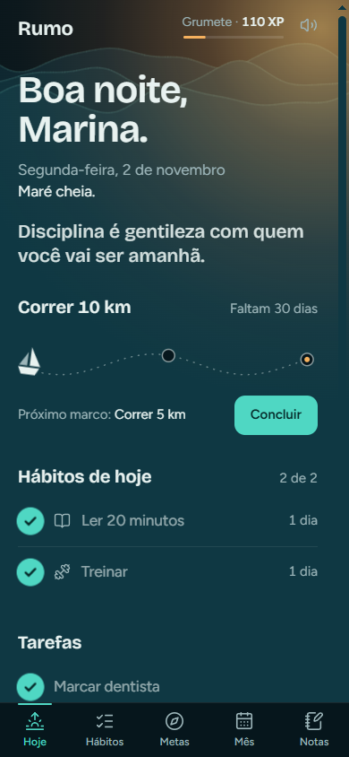
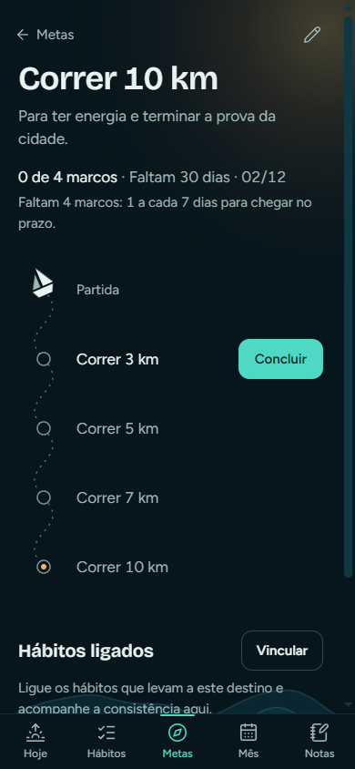
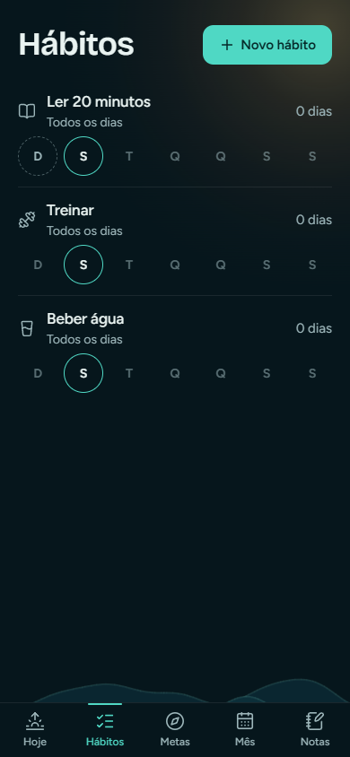
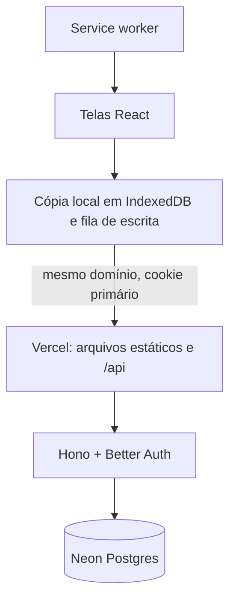

# Rumo

Metas, hábitos e planejamento do mês, tratados como uma viagem. Cada meta é uma rota, cada marco é uma estação e o dia é uma maré que sobe atrás da lista conforme você conclui as coisas.

PWA em português, instalável no celular, com o mesmo dado no celular e no computador. Nasceu para uso pessoal, com a base pronta para virar produto por assinatura.

**[Abrir o app](https://rumo-kappa-livid.vercel.app)** · O cadastro está fechado: o endereço mostra a tela de login.

<p>
  
  
  
</p>

Imagens com dados fictícios.

## Estado do projeto

Em desenvolvimento ativo.

| Etapa | Estado |
|---|---|
| Base, navegação e PWA | Concluída |
| Núcleo visual e tela Hoje | Concluída |
| Banco, API e login | Concluída e publicada |
| Hábitos com dados reais e uso offline | Concluída e publicada |
| Metas, marcos e vínculos com hábitos e tarefas | Concluída e publicada |
| Calendário do mês, semana e insights | Concluída e publicada |
| Notas, registro diário e recompensas | Concluída e publicada |
| Publicação, offline e acabamento | Concluída e publicada |
| Prioridades, subtarefas, tarefas recorrentes, foco e Pomodoro | Concluída e publicada |
| Evolução, gráficos, padrões e fluxos rápidos | Concluída e publicada |
| Rotina por dia da semana e relatório do dia no calendário | Concluída e publicada |
| Redesign escuro, quadro de tarefas, criar e buscar de qualquer tela e conquistas | Concluída e publicada |
| Treinos: fichas, biblioteca, modo treino e histórico | Concluída e publicada |
| Segurança e privacidade: RLS, exportar e excluir dados, termos | Concluída e publicada |
| Recuperação de senha | Planejada |

## Stack

| Camada | Tecnologia |
|---|---|
| Interface | React 19, TypeScript, Vite, Tailwind CSS 4, Motion |
| PWA | `vite-plugin-pwa` com Workbox |
| Dados no aparelho | TanStack Query com cópia em IndexedDB e fila de escrita |
| API | Hono em Vercel Functions |
| Login | Better Auth, com sessão em cookie primário |
| Banco | Postgres no Neon, com Drizzle ORM e migrações em SQL |
| Testes | Vitest, com testes de API contra um banco real |
| Hospedagem | Vercel e Neon, ambos em São Paulo |

## Arquitetura



App e API ficam no mesmo domínio de propósito: o cookie de sessão é primário e funciona no Safari do iPhone, onde cookies de outro domínio tendem a ser bloqueados.

## Decisões técnicas que valem a leitura

**Toque sem espera, com ou sem internet.** A tela muda antes de a rede responder, e cada escrita entra em uma fila salva no aparelho, que envia em ordem e sobrevive a fechar o app. Veja [`src/data/store.ts`](src/data/store.ts). A API entrega todos os dados do usuário em uma chamada, o que permite calcular XP e sequência sem rede e reduz as chamadas ao banco.

**Isolamento entre usuários em duas camadas.** Toda linha tem dono, e toda rota filtra pelo usuário da sessão. Além disso, os vínculos usam chaves estrangeiras compostas com `user_id`, então o próprio banco recusa ligar um marco à meta de outra pessoa, mesmo que uma rota erre.

**IDs gerados no cliente, com proteção no `ON CONFLICT`.** Para a fila offline poder repetir uma escrita sem duplicar nada, o `PUT` é idempotente e o ID vem do aparelho. Isso abre um risco: alguém poderia enviar o ID de uma linha alheia. Por isso a condição do conflito exige o mesmo dono. Veja [`server/routes/resource.ts`](server/routes/resource.ts).

**Sincronização sem conflito manual.** Exclusão suave impede que a fila de outro aparelho traga um item de volta, e a edição mais recente vence, com o horário limitado ao do servidor para um relógio adiantado não vencer para sempre.

**XP derivado dos dados, nunca salvo.** O bônus surpresa vem de um hash de hábito e data, então desmarcar e remarcar não rende pontos, e não há placar para sincronizar. Veja [`src/lib/xp.ts`](src/lib/xp.ts).

**Datas são dias locais.** Toda data é `YYYY-MM-DD` no fuso do usuário, vinda de uma única função. Com UTC, um hábito marcado às 22h no Brasil cairia no dia seguinte.

**Progresso que não engana.** O barco só anda com marco concluído, em ordem. Hábitos ligados à meta mostram consistência ao lado, sem empurrar a rota, então "quanto falta" nunca é inflado. Veja [`src/lib/goals.ts`](src/lib/goals.ts).

**Sequência que perdoa.** Uma falta a cada 7 dias não quebra a sequência. Veja [`src/lib/streaks.ts`](src/lib/streaks.ts).

**Animação proporcional à frequência.** O que acontece muitas vezes ao dia é quase imperceptível. A onda em tela cheia aparece só nos grandes momentos. Todo o movimento respeita `prefers-reduced-motion`.

## Testes

```bash
npm test
npm run test:server
```

`npm test` cobre a lógica pura: datas, hábitos, pausas, sequência, progresso do dia, XP, geometria da rota e preferência de som.

`npm run test:server` roda contra um banco Postgres real, em uma branch separada. Dois usuários tentam ler, sobrescrever, excluir e vincular os dados um do outro, além de cobrir idempotência, exclusão suave e conflito de edição. Testes de isolamento só valem se falham quando a proteção some, então isso foi conferido removendo a proteção de propósito.

## Como rodar

Precisa de Node 24 e de um banco Postgres no Neon.

```bash
npm install
cp .env.example .env
npm run db:migrate
npm run dev
```

Preencha o `.env` antes de migrar. O app abre em `http://localhost:5173`.

## Licença

Código publicado para consulta. Todos os direitos reservados.
